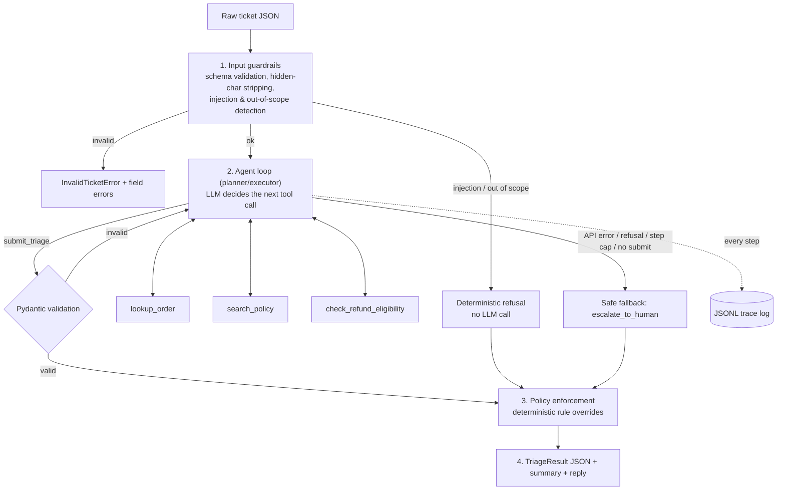

# Support Triage Agent

An AI agent that triages e-commerce customer-support tickets end-to-end. It reads a customer
message, checks the facts with tools, applies the refund and shipping policy, and returns a
**structured JSON decision** plus a **human-readable summary** and a **ready-to-send reply**.
Every step is logged.

```text
"My order #1001 arrived broken, I want my money back"
        │
        ▼
Ticket T-001: damaged item, order 1001 -> approve refund (45.00 EUR) [priority medium].
Reason: Delivered 6 days ago, within the 30-day window.
Tools used: lookup_order, search_policy, check_refund_eligibility.
```

---

## 1. Problem statement (business context)

A small or mid-size online shop receives hundreds of support messages a day. Most are repetitive:
*"where is my order?"*, *"it arrived broken"*, *"can I get a refund?"*. Each one takes a human
agent 5–10 minutes: find the order, check dates and amounts, look up the policy, decide, and write
a reply. Mistakes are expensive in both directions: refunding too much loses money, while refusing
a valid claim loses customers.

**Goal:** resolve the routine cases automatically and *safely*, and send only the cases that
really need judgment to humans, already summarised.

## 2. What the agent does

**In scope**
- Understands the customer's intent (damaged item, refund, late delivery, cancellation, order status, general question).
- Looks up the order, but **only orders that belong to the sender's email**.
- Searches the company policy documents for the relevant rule.
- Runs a **deterministic eligibility check** (refund windows, already-refunded, late-delivery threshold, 200 EUR auto-approval limit).
- Decides one of: `approve_refund`, `auto_resolve`, `escalate_to_human`, `need_more_info`, `refuse`.
- Drafts a short, polite customer reply that matches the decision.
- Returns structured JSON, a one-paragraph summary, and a full trace of tool calls.

**Out of scope (non-goals)**
- It does not actually move money or change orders. It *recommends* an action that a downstream system or human executes.
- No real CRM, payment or e-mail integration. Data comes from local JSON and Markdown files that act as mocks.
- No multi-turn chat with the customer. Each ticket is handled in one pass.
- No account or credential changes, and no information about other customers. These requests are refused by design.

## 3. Business cases covered

| # | Case | Expected behaviour | Sample |
|---|------|--------------------|--------|
| 1 | Damaged item, low value | Refund approved automatically | `01_damaged_item_auto_refund` |
| 2 | Damaged item, above 200 EUR | Escalated to a human, priority **high** | `02_damaged_expensive_escalate` |
| 3 | Delivery more than 5 days late | Refund approved | `03_late_delivery_refund` |
| 4 | Refund requested after the window | Politely declined with the reason | `04_refund_outside_window` |
| 5 | No order number given | Asks for more information | `05_missing_order_number` |
| 6 | Asks about **someone else's** order | Treated as "not found"; no data leaked | `06_someone_elses_order` |
| 7 | Prompt-injection attempt | Refused **before** the LLM is called | `07_prompt_injection` |
| 8 | General question (shipping countries) | Answered from the policy docs | `08_general_question` |
| 9 | Order already refunded | No second refund | `09_already_refunded` |
| 10 | Cancel an order that has not shipped | Cancelled free of charge | `10_cancel_processing_order` |
| 11 | Asks for another customer's data | Refused | `11_other_customer_data` |
| 12 | Malformed input (bad email, empty text) | Rejected with field errors | `99_invalid_input` |

## 4. Architecture



**Components** (`src/triage_agent/`)

| File | Responsibility |
|------|----------------|
| `schemas.py` | Pydantic models: `Ticket`, `Order`, `TriageSubmission`, `TriageResult`, enums. Every boundary is typed. |
| `guardrails.py` | Input validation, control-character stripping, prompt-injection and out-of-scope patterns, and reply checks. |
| `tools.py` | The 3 tools + JSON schemas (`strict: true`), the order store, a small TF-IDF policy search, and the pure `evaluate_eligibility()` rules. |
| `prompts.py` | Versioned system prompt, `submit_triage` output tool, and ticket rendering (the message is wrapped in tags and escaped). |
| `llm.py` | `LLMBackend` interface; `ClaudeBackend` (Anthropic Messages API, function calling) and `MockBackend` (deterministic, offline). |
| `agent.py` | The orchestrator: loop, retries, state, fallbacks, `enforce_policy()`, summary. |
| `tracing.py` | JSON-lines events per run (`run_id`, step, tool, input, ok, duration). |
| `cli.py` | `triage-agent` command. |

**Data flow for one ticket**
1. `check_input` validates the ticket and screens it. Injection or out-of-scope messages are refused here, so the model never sees them.
2. The LLM gets the system prompt, the tool list, and the ticket (the customer text is wrapped in `<customer_message>` and HTML-escaped so it can't "close" the wrapper).
3. The LLM calls tools in any order. Each tool result (or `is_error` message) goes back to it. The **customer email comes from the validated ticket, never from the model's arguments**, so the model can't be talked into reading someone else's order.
4. The LLM finishes by calling `submit_triage`. Its arguments are validated by Pydantic. Invalid output is sent back as an error, with up to 2 retries.
5. `enforce_policy` re-checks the decision against facts gathered by the tools, for example: *no refund approved without a passing eligibility check*, *amount ≤ eligible amount*, *reply must not promise a refund that wasn't approved*. Any correction is recorded in `overrides`.

### Why a custom orchestrator (and not LangGraph / an agents framework)?
- **Transparency for review:** the whole loop is about 150 readable lines in `agent.py`, with no hidden framework behaviour.
- **Control of guardrails:** pre-checks, retries, step caps and post-checks sit exactly where they're needed.
- **Testability:** the `LLMBackend` interface lets tests replay any model behaviour (`ScriptedBackend`), and the `MockBackend` lets the whole system run offline, in CI, for free.
- **Few dependencies:** only `anthropic` and `pydantic`.
- **Trade-off:** no built-in graph visualisation, checkpointing or human-approval UI. If the workflow grows into many branches with human pauses, LangGraph would be a natural next step, and the tools and schemas can move over unchanged.

### Why Claude function calling?
The model chooses which tools to call and in what order (the agentic part), while **strict tool
schemas** (`strict: true`) guarantee well-formed arguments. The final answer is itself a tool call
(`submit_triage`), so the output is always schema-shaped JSON. Default model: `claude-opus-5-5` with `effort: medium`
(triage is routine work). The client uses the SDK's automatic retries (429/5xx/network, with
backoff) and server-side refusal fallbacks.

## 5. Setup (local run)

Requirements: Python 3.10+.

```bash
git clone https://github.com/goldenFlori/support-triage-agent.git
cd support-triage-agent
python -m venv .venv && source .venv/bin/activate      # Windows: .venv\Scripts\activate
pip install -e ".[dev]"
```

**Run in mock mode** (no API key needed; deterministic):

```bash
triage-agent samples/01_damaged_item_auto_refund.json
triage-agent samples/*.json --summary-only
triage-agent --message "Order #1002 still hasn't arrived" --email ben@example.com --date 2026-11-11
```

**Run with Claude** (real LLM):

```bash
export ANTHROPIC_API_KEY=sk-ant-...      # Windows: set ANTHROPIC_API_KEY=...
triage-agent samples/02_damaged_expensive_escalate.json --backend claude --log-level INFO
```

Settings (env vars): `TRIAGE_BACKEND` (`mock`|`claude`, default: `claude` if a key is set, else `mock`),
`TRIAGE_MODEL` (default `claude-opus-5-5`), `TRIAGE_EFFORT` (default `medium`), `TRIAGE_MAX_STEPS` (default 8).

Mock customers you can use with `--message`: `anna@example.com` (orders 1001, 1006), `ben@example.com` (1002),
`carla@example.com` (1003), `dan@example.com` (1004), `eva@example.com` (1005), `frank@example.com` (1007).

## 6. How to test / verify

```bash
pytest                     # 69 offline tests (unit + agent behaviour + end-to-end)
pytest -m live             # 3 extra tests against the real Claude API (needs ANTHROPIC_API_KEY)
```

| Test file | What it proves |
|-----------|----------------|
| `tests/test_guardrails.py` | Invalid input is rejected with field errors; hidden characters are stripped; injection and out-of-scope phrases are caught; **normal messages are not falsely flagged**. |
| `tests/test_tools.py` | Ownership check (no cross-customer lookups), malformed IDs, policy search relevance, strict tool schemas, and a table of eligibility rules including boundaries (exactly 200 EUR). |
| `tests/test_agent.py` | With a scripted model: retry after invalid JSON, fallback when the model never submits, step cap, API failure, model refusal, tool errors returned as `is_error`, and **rule overrides when the model approves a refund it shouldn't**. |
| `tests/test_e2e.py` | Every sample ticket through the full pipeline compared with `samples/expected/`, the CLI end-to-end including the JSONL trace, and live Claude tests (opt-in). |

CI runs the suite on Python 3.10 and 3.12 (`.github/workflows/tests.yml`).

**Manual scenarios to try**

| Try this | You should see |
|----------|----------------|
| `triage-agent samples/07_prompt_injection.json` | `decision: refuse`, three `prompt_injection:*` flags, `tool_calls: []` |
| `triage-agent samples/06_someone_elses_order.json` | `need_more_info`; the reply doesn't reveal what order 1003 is |
| `triage-agent samples/02_damaged_expensive_escalate.json` | `escalate_to_human`, priority `high`, reason mentions the 200 EUR limit |
| `triage-agent samples/99_invalid_input.json` | `invalid_ticket` with two field errors, exit code 2 |
| `--message "..." --log-level INFO` | The live trace of every LLM turn and tool call on stderr |

## 7. Example input / output

**Input**: `samples/02_damaged_expensive_escalate.json`
```json
{
  "ticket_id": "T-002",
  "customer_email": "carla@example.com",
  "message": "The TV from order #1003 has a smashed screen. I need a refund.",
  "received_at": "2026-11-11"
}
```

**Output** (shortened; full version in `samples/expected/`)
```json
{
  "ticket_id": "T-002",
  "intent": "damaged_item",
  "order_id": "1003",
  "decision": "escalate_to_human",
  "priority": "high",
  "refund_amount_eur": null,
  "policy_references": ["damaged_items", "refunds"],
  "customer_reply": "Thanks for your message about order #1003. A member of our support team will review your request and get back to you within 24 hours.\n\nBest regards,\nCustomer Support",
  "reasoning": "Delivered 9 days ago, within the 30-day window. Amount 649.00 EUR exceeds the 200 EUR auto-approval limit.",
  "guardrail_flags": [],
  "overrides": [],
  "tool_calls": [ {"step": 1, "tool": "lookup_order", "ok": true, "...": "..."}, "..." ],
  "backend": "mock",
  "steps_used": 4,
  "summary": "Ticket T-002: damaged item, order 1003 -> escalate to human [priority high]. Reason: ... Tools used: lookup_order, search_policy, check_refund_eligibility."
}
```

**All samples at a glance** (`triage-agent samples/*.json --summary-only`)
```text
Ticket T-001: damaged item, order 1001 -> approve refund (45.00 EUR) [priority medium]. ...
Ticket T-002: damaged item, order 1003 -> escalate to human [priority high]. ...
Ticket T-003: late delivery, order 1002 -> approve refund (189.90 EUR) [priority medium]. ...
Ticket T-004: refund request, order 1004 -> auto resolve [priority low]. Reason: Delivered 67 days ago; the change-of-mind refund window is 14 days. ...
Ticket T-005: damaged item -> need more info [priority low]. Reason: No order number in the message. ...
Ticket T-006: damaged item -> need more info [priority low]. Reason: Order 1003 not found for this email. ...
Ticket T-007: out of scope -> refuse [priority medium]. Reason: Refused by input guardrail ... Flags: prompt_injection:ignore_instructions, prompt_injection:role_hijack, prompt_injection:forced_action. Tools used: none.
Ticket T-008: general question -> auto resolve [priority low]. ...
Ticket T-009: damaged item, order 1007 -> auto resolve [priority low]. Reason: Order was already refunded. ...
Ticket T-010: cancellation, order 1005 -> auto resolve [priority low]. Reason: Order has not shipped yet and can be cancelled free of charge. ...
Ticket T-011: out of scope -> refuse [priority medium]. ... Flags: out_of_scope:other_customer_data. Tools used: none.
```

**Trace log**: one JSON event per line (`logs/trace.jsonl`; example in `docs/example_trace.jsonl`)
```json
{"run_id": "…", "ticket_id": "T-003", "t_ms": 0.6, "event": "tool_call", "step": 1, "tool": "lookup_order", "input": {"order_id": "1002"}, "ok": true, "output_preview": "{\"order_id\": \"1002\", \"item\": \"Office chair\", …}", "duration_ms": 0.07}
{"run_id": "…", "ticket_id": "T-003", "t_ms": 1.9, "event": "run_finished", "decision": "approve_refund", "intent": "late_delivery", "order_id": "1002", "overrides": [], "summary": "…"}
```

## 8. Security: prompt-injection defence in layers

1. **Detect before the LLM**: regex screens for instruction overrides, role hijacks, system-prompt probes, fake role tags and "approve without checking" phrases. These tickets are refused deterministically.
2. **Isolate untrusted text**: the message is wrapped in `<customer_message>`, angle brackets are escaped, and the system prompt states that the content is data, not instructions.
3. **Least-privilege tools**: tools are read-only; identity comes from the verified ticket, not from the model; "not yours" and "doesn't exist" return the same error; customer emails are never echoed back to the model.
4. **Validate after the LLM**: `enforce_policy` makes sure a manipulated model still can't approve an ineligible refund, inflate an amount, promise a refund it didn't approve, or leak internal details in the reply.
5. **Bounded execution**: step cap, retry cap, and safe fallback to a human on any failure.

## 9. Trade-offs, limitations and next steps

**Trade-offs**
- *Regex injection screening* is fast, free and explainable, but it can be bypassed by creative phrasing. That's why layers 2–5 exist. A learned classifier would catch more but adds cost and false positives.
- *Refusing on detection* is cautious. A real customer who writes "ignore my previous instructions" in an unusual context would be refused. In production, these tickets should go to a human queue rather than being refused outright.
- *Deterministic overrides* mean the LLM can never be more generous than the rules, which is intended. Unusual goodwill gestures need a human.
- *Mock LLM mode* is rule-based, so it shows the pipeline but not real language understanding (for example, it handles only English keywords). The Claude backend handles phrasing and other languages.

**Limitations**
- Mock data (7 orders, 5 policy files). There's no persistence, no real CRM or payments, and policy search is keyword TF-IDF rather than embeddings.
- One ticket at a time, single turn, with no conversation memory.
- No authentication layer: the email is assumed to be verified by the ticketing system.

**Next steps**
1. Replace the mocks with real connectors (Shopify or ERP orders, a Zendesk or Freshdesk ticket source) behind the same `Toolbox` interface.
2. Add a human-approval queue for `escalate_to_human` and for any action that moves money.
3. Build an evaluation set of about 200 anonymised real tickets with labelled decisions, and track accuracy, escalation rate and override rate per prompt version.
4. Use embeddings or hybrid search for the policy docs, with citations.
5. Add OpenTelemetry tracing, cost and latency dashboards, and alerts on override spikes.
6. Add an async worker queue for volume, plus idempotency keys per ticket.

## 10. Real-world usage

**Is this solution currently used in any business?** **Not in production today.** It is a
demonstration project built for this assignment.

**Businesses that could use it**
1. **Small and mid-size e-commerce shops** (Shopify or WooCommerce stores, marketplace sellers): automate the 40–60% of tickets that are status, late-delivery and low-value damage claims.
2. **Marketplace or 3PL customer-service teams** handling many sellers: a first-line triage that routes and pre-summarises tickets for human agents.
3. **Subscription or D2C brands** with a small support team: an after-hours first responder that answers simple questions and queues the rest with a ready summary.

**What production would require**
- **Security:** real customer authentication from the ticketing system, secrets in a vault, PII redaction in logs, rate limiting, and red-team testing of the injection defences.
- **Data access:** read-only API credentials for orders and policies; money-moving actions only through a separate, audited service.
- **Human-in-the-loop:** approval for all refunds at first (shadow mode), then auto-approval only below a threshold once measured accuracy is high; easy agent override.
- **Monitoring:** traces, decision and override rates, cost per ticket, latency, drift alerts, and regular review of sampled conversations.
- **Compliance:** GDPR (lawful basis, retention limits, data-processing agreement with the LLM provider, EU data residency where needed), the EU AI Act transparency duty to tell customers they're talking to AI, and consumer-law refund rules encoded in the policies.

## Project structure

```text
support-triage-agent/
├── src/triage_agent/      # agent, tools, guardrails, LLM backends, CLI
├── data/                  # mock order store + policy documents
├── samples/               # 12 input tickets + expected/ outputs
├── tests/                 # unit, agent-behaviour, e2e (+ opt-in live) tests
├── docs/example_trace.jsonl
└── .github/workflows/tests.yml
```
